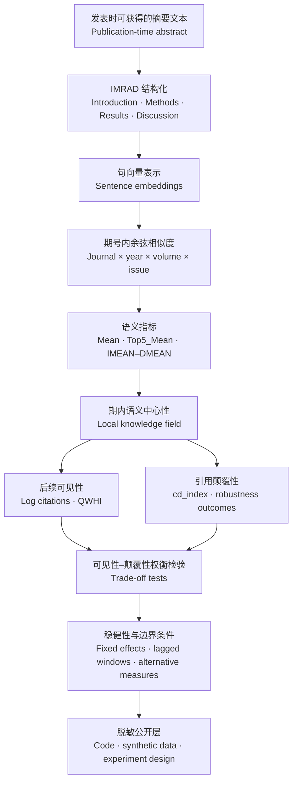

# PaperInsight

**Making scientific influence measurable before it becomes visible in citation counts.**

> **中文简介：** PaperInsight 是一个面向科学评价研究的脱敏开源工具包。项目关注论文“被看见”和“改变知识结构”是否是同一件事：通过摘要的 IMRAD 结构、期号内语义相似度和后续引用结果，构建一条可审计、可复现的研究流程。公开仓库只提供工程代码、合成样例和实验设计，不公开原始论文数据或私有论文材料。

PaperInsight is an open, sanitized research toolkit for studying how the language of a paper—especially its position within a journal issue—relates to two dimensions of scientific influence:

- **Visibility:** Will later work find, use, and cite the paper?
- **Disruption:** Will later work build on the paper as an alternative to the issue's prevailing knowledge structure?

The project turns that research question into an auditable workflow: structure abstracts, measure issue-level semantic position, connect publication-time signals to downstream citation outcomes, and test whether visibility and disruption move together or trade off.

## Why this project matters

Citation counts are useful, but they arrive late and compress different kinds of influence into one number. A highly cited paper may reinforce an established conversation; a less visible paper may introduce a more disruptive direction. PaperInsight provides a way to examine that distinction systematically and to make the measurement process explicit.

The working research proposition is a **visibility–disruption trade-off**: semantic centrality may help a paper become visible within the knowledge field surrounding its publication, while reducing the likelihood that it displaces that field's dominant patterns. This is an empirical question, not a causal claim, and the toolkit is designed to expose the assumptions needed to evaluate it.

## Research logic / 研究思路



中文理解：论文摘要先被拆分为 IMRAD 四个功能部分，再通过句向量和期号内比较构造语义中心性。中心性随后分别连接到“后续可见性”和“引用颠覆性”两条结果路径，最后通过固定效应、滞后窗口、替代指标和边界条件检验研究命题。期号被视为一个局部知识场；`RMEAN` 用来观察 Results 部分是否承担了主要机制作用。

The issue is treated as a **local knowledge field**: each paper is compared with papers in the same journal, year, volume, and issue. IMRAD-level measures make it possible to ask not only whether a paper is central, but which part of its argument carries the association. The Results component (`RMEAN`) is therefore examined as a mechanism candidate rather than hidden inside a single aggregate score.

## What this repository demonstrates

- A reproducible schema for paper-level semantic and citation-disruption analysis.
- Entropy-weighted and equal-weight IMRAD aggregation.
- Issue and year fixed effects with issue-clustered uncertainty.
- Synthetic data generation for safe pipeline testing.
- A documented bridge from exploratory analysis to robustness experiments.
- A strict separation between public engineering and private empirical materials.

The public repository contains reusable code, a schema-compatible synthetic dataset, and a documented experimental design. It does **not** contain the private corpus, article-level metadata, manuscript drafts, target-journal materials, or empirical output files.

## 工程模块 / Engineering modules

| 模块 | 中文说明 | Public implementation |
| --- | --- | --- |
| 数据与样例 | 用合成数据验证字段、范围和执行流程 | `data/sample/`, `make_sample_data.py` |
| 语义测量 | 计算 IMRAD 语义相似度与期内中心性 | `semantic_disruption.py` |
| 统计建模 | 固定效应、稳健不确定性和加权分析 | `semantic_disruption.py` |
| 研究设计 | 明确估计对象、稳健性检验和数据质量门槛 | [`docs/EXPERIMENT_DESIGN.md`](docs/EXPERIMENT_DESIGN.md) |
| 发现记录 | 汇总阶段成果，同时隔离私有实证数据 | [`docs/RESEARCH_FINDINGS.md`](docs/RESEARCH_FINDINGS.md) |

## What is included

- `src/zpaper/semantic_disruption.py` — schema validation, feature preparation, entropy-weighted IMRAD construction, fixed-effect regression, and report generation.
- `src/zpaper/make_sample_data.py` — deterministic synthetic data generator.
- `data/sample/` — synthetic paper-level records and metadata with no real papers, authors, or DOIs.
- `docs/RESEARCH_FINDINGS.md` — sanitized stage-by-stage findings and evidence map.
- `docs/EXPERIMENT_DESIGN.md` — current design, estimands, robustness checks, and next experiments.
- `docs/DATA_POLICY.md` — public/private data boundary and release checklist.
- `docs/PROJECT_STRUCTURE.md` — repository layout and workflow.

## Quick start

```powershell
python -m venv .venv
.\.venv\Scripts\Activate.ps1
pip install -e .
python -m zpaper.make_sample_data
python -m zpaper.semantic_disruption
```

The demo writes tables and a Markdown report to `outputs/demo_semantic_disruption/`. That directory is ignored by Git. The demo verifies the pipeline only; it is not evidence for the research findings.

## Run with a private or approved dataset

Prepare a CSV following [`docs/DATA_POLICY.md`](docs/DATA_POLICY.md), then run:

```powershell
python -m zpaper.semantic_disruption `
  --input data/private/your_dataset.csv `
  --output-dir outputs/your_run
```

Keep private data under `data/private/` or outside the repository. Never place raw records, author names, real DOI lists, manuscript text, or derived empirical outputs in `data/sample/`.

## Current research status

The engineering package is reproducible on synthetic data. The empirical findings summarized in [`docs/RESEARCH_FINDINGS.md`](docs/RESEARCH_FINDINGS.md) are a sanitized research record derived from a private working corpus and are not recreated by the demo dataset. The project remains observational: reported associations should not be read as causal effects.

## License

Code is released under the MIT License. Synthetic data is released for demonstration and testing only.
