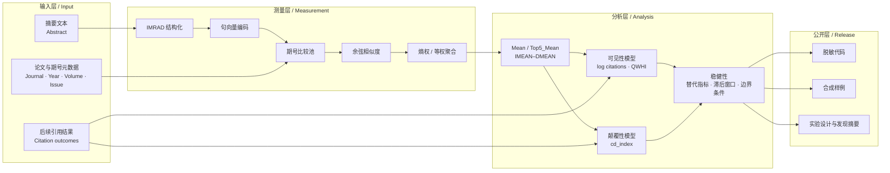

# PaperInsight 工程架构

## 一、项目定位

PaperInsight 将一个科学评价问题转化为可审计的计算流程：

> 论文在发表时所处的局部语义环境，是否能够解释它后来获得的可见性，以及它是否会改变既有知识结构？

项目不把引用次数当作单一的“影响力真值”，而是将科学影响拆成两条可比较的结果路径：

1. **可见性（Visibility）**：后续研究是否发现、使用并引用论文；
2. **颠覆性（Disruption）**：后续引用是否更像是在替代既有知识结构，而不是巩固它。

## 二、工程流程图

## 三、模块职责

| 层级 | 主要职责 | 公开内容 |
| --- | --- | --- |
| 输入层 | 定义摘要、期号、控制变量和下游结果的 schema | 合成 CSV 与 JSON |
| 测量层 | 结构化文本、编码、构建局部比较池并计算相似度 | `src/zpaper/semantic_disruption.py` |
| 分析层 | 熵权 IMRAD、固定效应回归、可见性/颠覆性双结果比较 | Python 实现与设计文档 |
| 验证层 | 缺失值、样本筛选、替代因变量、滞后窗口和边界条件 | 实验设计说明 |
| 公开层 | 将可复用工程与私有实证材料隔离 | 合成数据、脱敏文档和 MIT 代码 |

## 四、数据边界

公开仓库不包含：

- 原始论文记录、真实 DOI、作者字符串和摘要原文；
- 私有论文全文、手稿、目标期刊材料和审稿材料；
- 论文级经验结果、图表原文件和私有引用网络；
- 含本地绝对路径、凭据或私有接口的工作脚本。

因此，公开 demo 的目标是验证**代码能否运行、schema 是否一致、输出是否可检查**，而不是重现私有语料上的经验系数。

## 五、研究解释边界

- 语义中心性与后续结果的关系是观察性关联，不自动构成因果效应。
- IMRAD 来自摘要时，不能等同于全文结构。
- 期号比较池刻画的是局部知识环境，不代表整个学科的全局中心性。
- 单一领域、单一颠覆性指标或单一引用窗口都需要外部验证。
